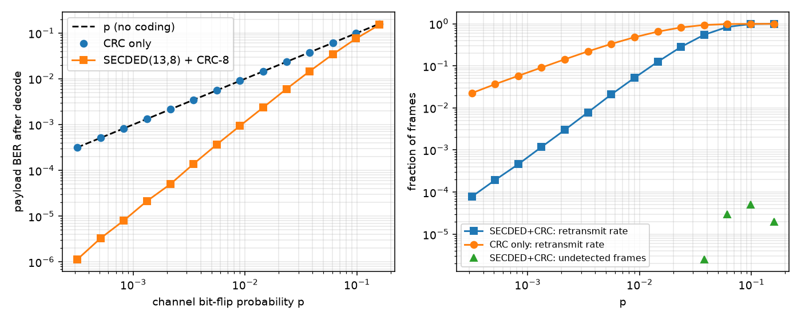
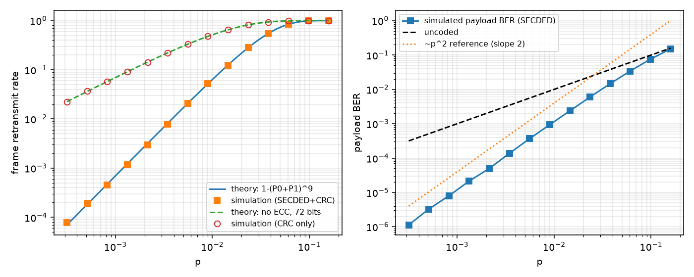

# SECDED (13,8) + CRC-8 Error-Control System

A Verilog-based error-control design combining **Single Error Correction, Double Error Detection (SECDED)** with **CRC-8 error detection**, supported by exhaustive RTL verification, mutation testing, Yosys synthesis, post-synthesis validation, and Python-based BER analysis.

## 1. Project Overview

This project implements a shortened Hamming SECDED code for protecting 8-bit data words, together with a CRC-8 module for frame-level error detection.

### Key Features

- SECDED(13,8) encoder and decoder.
- Single-bit error correction and double-bit error detection.
- CRC-8 implementation using polynomial `0x07`.
- Exhaustive functional verification.
- Mutation testing of decoder logic.
- Triple-bit error injection and silent-corruption analysis.
- Python-based Monte Carlo BER modelling.
- Yosys generic logic synthesis.
- Post-synthesis netlist validation.

### Tools Used

- Verilog HDL
- Icarus Verilog 12.0
- GTKWave
- Yosys 0.33
- Python 3
- NumPy
- Matplotlib
- Git

### Implementation Status

| Component | Status |
|---|---|
| SECDED encoder and decoder | Completed |
| CRC-8 module | Completed |
| Functional verification | Completed |
| Mutation testing | Completed |
| Triple-bit error analysis | Completed |
| Python BER modelling | Completed |
| Yosys synthesis | Completed |
| Post-synthesis validation | Completed |
| FPGA hardware validation | Not performed |

---

## 2. System Architecture

The project contains three primary RTL modules.

| Module | Function |
|---|---|
| `secded_enc` | Encodes 8-bit data into a 13-bit SECDED codeword |
| `secded_dec` | Detects and corrects single-bit errors and flags double-bit errors |
| `crc_8` | Computes CRC-8 for an 8-bit input byte |

### Combined Frame Format

The behavioural model uses an eight-byte payload followed by one CRC byte.

| Field | Size |
|---|---:|
| Payload | 8 bytes |
| CRC-8 | 1 byte |
| Total | 9 bytes |

Each byte is independently encoded using SECDED(13,8).

\[
9 \times 13 = 117 \text{ bits per frame}
\]

The receiver performs SECDED decoding followed by CRC verification.

---

## 3. SECDED(13,8) Codeword Layout

The first 12 positions follow the conventional Hamming arrangement. The thirteenth position contains overall parity.

**Verilog bit index = codeword position - 1**

| Position | Bit Index | Contents |
|---:|---:|---|
| 1 | 0 | p1 |
| 2 | 1 | p2 |
| 3 | 2 | d1 |
| 4 | 3 | p4 |
| 5 | 4 | d2 |
| 6 | 5 | d3 |
| 7 | 6 | d4 |
| 8 | 7 | p8 |
| 9 | 8 | d5 |
| 10 | 9 | d6 |
| 11 | 10 | d7 |
| 12 | 11 | d8 |
| 13 | 12 | Overall parity |

### Hamming Parity Equations

```verilog
p1 = d1 ^ d2 ^ d4 ^ d5 ^ d7;
p2 = d1 ^ d3 ^ d4 ^ d6 ^ d7;
p4 = d2 ^ d3 ^ d4 ^ d8;
p8 = d5 ^ d6 ^ d7 ^ d8;
```

Overall parity:

```verilog
P = d1 ^ d2 ^ d3 ^ d5 ^ d6 ^ d8;
```

---

## 4. SECDED Decoder Logic

The decoder calculates:

1. A four-bit syndrome using the Hamming parity groups.
2. Overall parity (`ptot`) using all 13 received bits.

### Error Classification

| Syndrome | `ptot` | Interpretation |
|---|---:|---|
| 0 | 0 | No error |
| 0 | 1 | Overall parity-bit error |
| 1–12 | 1 | Single-bit error |
| 13–15 | 1 | Invalid shortened-code position |
| Nonzero | 0 | Double-bit error |

For a valid single-bit error, the decoder generates a correction mask:

```verilog
corrected_word = received_word ^ (13'b1 << (syn - 1));
```

Syndromes 13, 14 and 15 are flagged as uncorrectable.

---

## 5. CRC-8 Implementation

The CRC module uses:

| Parameter | Value |
|---|---|
| Polynomial | `0x07` |
| Initial CRC | `0x00` |
| Processing | MSB-first |
| Input width | 8 bits |
| CRC width | 8 bits |

The generator polynomial is:

\[
G(x)=x^8+x^2+x+1
\]

CRC is calculated sequentially over the eight payload bytes.

### CRC Verification

A reference-vector testbench evaluates 1,000 frames.

**Result: 1,000 / 1,000 passed with zero mismatches.**

---

## 6. Repository Structure

```text
SECDED/
├── rtl/
│   ├── secded_enc.v
│   ├── secded_dec.v
│   └── crc8_byte.v
│
├── tb/
│   ├── secded_enc_tb.v
│   ├── secded_codec_tb.v
│   ├── secded_vec_tb.v
│   ├── triple_flip_tb.v
│   ├── crc8_tb.v
│   ├── crc_vector_tb.v
│   └── hello_tb.v
│
├── SYNTH/
│   ├── netlists/
│   ├── reports/
│   ├── scripts/
│   └── validation/
│
├── models/
│   ├── pipeline_model.py
│   ├── make_plots.py
│   └── sweep.csv
│
├── results/
│   ├── ber_sweep.png
│   └── ber_theory_overlay.png
│
├── vectors.mem
├── crc_frames.mem
├── .gitignore
└── README.md
```

---

## 7. Functional Verification

The RTL design was verified using Icarus Verilog.

### Main SECDED Codec Testbench

All 256 possible 8-bit input combinations were tested.

| Test | Cases | Result |
|---|---:|---|
| Encoder parity | 256 | 0 failures |
| No-error test | 256 | 0 failures |
| Single-bit error test | 3,328 | 0 failures |
| Double-bit error test | 19,968 | 0 failures |
| **Total** | **23,808** | **0 failures** |

Single-bit error cases:

\[
256 \times 13 = 3,328
\]

Double-bit error cases:

\[
256 \times \binom{13}{2} = 19,968
\]

### Reference-Vector Verification

| Test | Cases | Result |
|---|---:|---|
| SECDED reference vectors | 23,552 | 0 mismatches |
| CRC-8 reference frames | 1,000 | 0 mismatches |

---

## 8. Mutation Testing

Intentional decoder modifications were introduced to evaluate testbench effectiveness.

| Mutation | No-error failures | Single-error failures | Double-error failures |
|---|---:|---:|---:|
| Original design | 0 | 0 | 0 |
| Change `syn <= 12` to `syn <= 11` | 0 | 256 | 0 |
| Flip one bit of mask M4 | 128 | 1,408 | 640 |
| Apply both mutations | 128 | 1,536 | 640 |
| Remove `(syn > 0)` guard | 0 | 0 | 0 |

The equivalent mutant produced no failures in the tested simulation.

---

## 9. Triple-Bit Error Analysis

All possible combinations of three flipped bits were applied to all 256 input values.

\[
\binom{13}{3}=286
\]

\[
286 \times 256 = 73,216 \text{ cases}
\]

### Results

| Outcome | Cases | Share |
|---|---:|---:|
| Detected | 16,896 | 23.1% |
| Lucky | 0 | 0.0% |
| Silent corruption | 56,320 | 76.9% |
| **Total** | **73,216** | **100%** |

These results describe the behaviour of this specific implementation under exhaustive triple-bit error injection. They are not real-world failure probabilities.

### Combined SECDED Simulation Coverage

| Simulation | Cases |
|---|---:|
| Main codec testbench | 23,808 |
| Triple-bit testbench | 73,216 |
| **Total** | **97,024** |

---

## 10. Python-Based BER Analysis

A separate Python behavioural model was developed using NumPy to evaluate the combined SECDED + CRC system over a Binary Symmetric Channel (BSC).

### Simulation Configuration

- Frame size: 9 bytes.
- Encoded frame size: 117 bits.
- Frames per channel probability: 400,000.
- Number of channel probabilities: 14.
- Random seed: `2026`.
- Channel model: Independent bit flips with probability `p`.

### Compared Configurations

**SECDED + CRC-8**

- SECDED encoding of payload and CRC.
- Bit-error injection.
- SECDED decoding.
- CRC verification.

**Uncoded CRC-8 baseline**

- Payload and CRC transmitted without SECDED.
- CRC verification at the receiver.

### BER Results

| Channel BER | SECDED + CRC Post-BER | Uncoded CRC Post-BER | Retransmission Rate |
|---:|---:|---:|---:|
| 3.16e-4 | 1.13e-6 | 3.15e-4 | 7.750e-5 |
| 5.10e-4 | 3.28e-6 | 5.17e-4 | 1.925e-4 |
| 8.23e-4 | 8.01e-6 | 8.26e-4 | 4.575e-4 |
| 1.33e-3 | 2.14e-5 | 1.33e-3 | 1.177e-3 |
| 2.14e-3 | 4.97e-5 | 2.14e-3 | 2.992e-3 |
| 3.46e-3 | 1.38e-4 | 3.46e-3 | 7.865e-3 |
| 5.57e-3 | 3.66e-4 | 5.59e-3 | 2.082e-2 |
| 8.99e-3 | 9.35e-4 | 9.02e-3 | 5.181e-2 |
| 1.45e-2 | 2.36e-3 | 1.45e-2 | 1.247e-1 |
| 2.34e-2 | 5.98e-3 | 2.34e-2 | 2.814e-1 |
| 3.78e-2 | 1.46e-2 | 3.78e-2 | 5.477e-1 |
| 6.09e-2 | 3.43e-2 | 6.09e-2 | 8.424e-1 |
| 9.82e-2 | 7.56e-2 | 9.82e-2 | 9.844e-1 |
| 1.58e-1 | 1.51e-1 | 1.58e-1 | 9.999e-1 |

The model measures post-decoding payload BER before retransmission-based frame rejection. Undetected frames are also tracked separately.

### BER Sweep



### Theoretical Reference Overlay



The theoretical curves are simplified reference models. The maximum relative deviation between the simulated SECDED retransmission rate and its reference curve was 10.7% at the lowest simulated channel probability.

---

## 11. Yosys Synthesis

The three RTL modules were synthesized independently using Yosys.

### Generic Cell Counts

| Module | Generic Cells |
|---|---:|
| SECDED encoder | 18 |
| SECDED decoder | 108 |
| CRC-8 | 40 |
| **Total** | **166** |

### Cell Breakdown

**SECDED Encoder**
- 18 XOR cells.

**SECDED Decoder**
- 14 AND cells.
- 37 MUX cells.
- 9 NOT cells.
- 11 OR cells.
- 37 XOR cells.

**CRC-8**
- 16 MUX cells.
- 16 NOT cells.
- 8 XOR cells.

Generated netlists are stored in `SYNTH/netlists/`, and synthesis reports are stored in `SYNTH/reports/`.

These are generic logic-cell counts, not FPGA LUT utilization, ASIC area, or physical timing measurements.

---

## 12. Post-Synthesis Netlist Validation

The synthesized Verilog netlists were validated using Icarus Verilog.

| Validation | Cases / Frames | Result |
|---|---:|---|
| SECDED encoder netlist | 256 | 0 failures |
| Combined SECDED codec netlists | 23,808 | 0 failures |
| SECDED reference-vector netlist | 23,552 | 0 mismatches |
| CRC-8 netlist | 1,000 | 0 mismatches |
| **Total** | **48,616** | **0 failures/mismatches** |

The total is the sum of separate validation runs, not a count of unique vectors.

---

## 13. Limitations

- SECDED does not guarantee correct recovery from three or more bit errors.
- Triple-bit error analysis demonstrates possible silent corruption.
- The Python model is a behavioural reference model, not direct RTL co-simulation.
- The channel model assumes independent bit errors.
- CRC-8 has a finite undetected-error probability.
- Generic synthesis results do not represent physical area or timing.
- No FPGA hardware validation has been performed.
- No ASIC physical implementation or timing closure has been performed.

---

## 14. Future Work

- [ ] Direct RTL co-simulation with the Python behavioural model.
- [ ] Comparison with parity-only and unprotected implementations.
- [ ] FPGA synthesis and resource utilization analysis.
- [ ] Timing analysis and critical-path investigation.
- [ ] FPGA hardware validation.
- [ ] Extension to wider data words.
- [ ] Investigation of correlated multi-bit errors.
- [ ] Evaluation of alternative CRC polynomials.

---

## 15. Project Significance

This project combines error-control coding, digital logic design, exhaustive verification, fault injection, synthesis and behavioural reliability analysis.

It provides practical experience with:

- Verilog RTL design.
- Syndrome-based error correction.
- CRC-based error detection.
- Exhaustive testbench development.
- Mutation testing.
- Multi-bit fault analysis.
- Yosys synthesis.
- Post-synthesis netlist validation.
- Python-based BER modelling.
